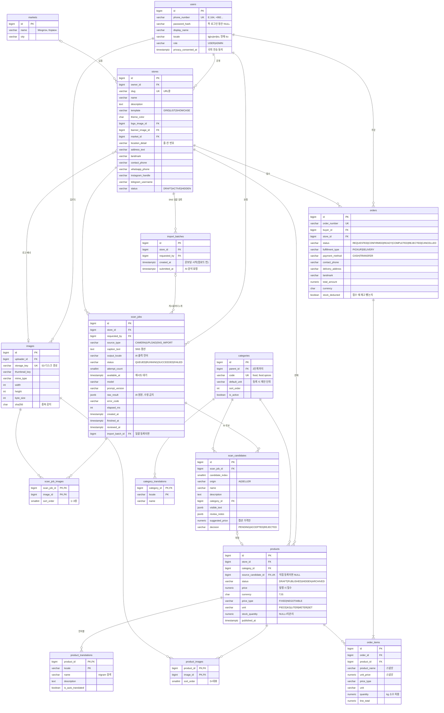

# BOZOR ERD v1

- 작성일: 2026-10-11 (7주차 시작 전)
- DDL(Flyway 마이그레이션, 실제 DB의 기준): [V1__init_schema.sql](../backend/src/main/resources/db/migration/V1__init_schema.sql), 기준 데이터 [V2__reference_data.sql](../backend/src/main/resources/db/migration/V2__reference_data.sql). PostgreSQL 18에서 적용·흐름·제약 조건까지 검증했다.
- 개발용 목 데이터: [R__dev_mock_data.sql](../backend/src/main/resources/db/dev/R__dev_mock_data.sql) (dev 프로필 전용)
- 구현 후 바뀐 점(2026-10-11): `orders.stock_deducted` 추가(접수 때 재고 빼기를 고른 주문), 상품 `DRAFT → ARCHIVED` 허용. 스키마를 바꿀 때는 V1을 고치지 말고 새 버전 파일(V3__...)을 추가한다.
- 2026-10-12: [V3__import_batches.sql](../backend/src/main/resources/db/migration/V3__import_batches.sql) — SNS 사진 일괄 등록 묶음(`import_batches`)과 `scan_jobs.import_batch_id` 추가(결정 18).
- 현지 조사 근거: [01-tajikistan-research.md](01-tajikistan-research.md)
- 임시 설정(목 로그인·한국어·템플릿·카테고리)과 실증 전 변경 목록: [00-temporary-decisions.md](00-temporary-decisions.md)
- 범위: 2차 회의에서 정한 **이번 학기 핵심 기능**. 사진 업로드 → AI 상품 정보 생성 → 판매자 검수 → 발행, 상점·상품 조회·검색, 주문(결제·배송 제외), 인증.

## 다이어그램



공통 컬럼 `created_at`·`updated_at`은 다이어그램에서 대부분 생략했다. 테이블은 15개다(V3에서 `import_batches` 추가).

## 핵심 흐름과 테이블

```
① 촬영·업로드        images ← scan_job_images → scan_jobs (QUEUED)
② AI 분석(비동기)     워커가 scan_jobs를 RUNNING → SUCCEEDED로 바꾸고 raw_result 저장
                     → scan_candidates (origin=AI, decision=PENDING)
③ 판매자 검수         후보 수락/거절, 누락 상품 추가(origin=SELLER)
                     → products (DRAFT) + product_translations + product_images
④ 발행               products.status = PUBLISHED (가격 필수)
⑤ 구매자 검색·주문    product_translations(trigram) → orders + order_items
```

## 설계 결정과 근거

| # | 결정 | 이유 |
|---|---|---|
| 1 | 판매자·구매자 테이블을 나누지 않음. 상점을 가진 사용자 = 판매자 | 시장 상인도 다른 가게에서 물건을 산다. 역할 전환을 단순하게 하기 위해서. |
| 2 | **비동기 `scan_jobs`** | 2차 회의 결정. PoC는 요청 하나가 최대 300초를 기다린다. 현지 모바일 속도도 하위권이다(조사 §1). 워커는 `available_at`이 지난 Job을 `FOR UPDATE SKIP LOCKED`로 가져간다(검증 완료). 재시도할 때는 `available_at`을 뒤로 미룬다. |
| 3 | `raw_result`(AI 원본)는 수정하지 않고, 확정본은 별도 테이블에 둠 | PoC에서 가장 잘한 설계라 그대로 이어간다. 모델이나 프롬프트를 바꿨을 때 전후 비교가 가능하다. |
| 4 | **판매자가 추가한 누락 상품도 `scan_candidates`(origin=SELLER)에 넣음** | 2차 지표(카테고리 정확도 80%)와 정밀도·재현율이 SQL 한 줄로 나온다(아래 쿼리 참고). |
| 5 | 사진 1~3장 = `scan_job_images` | 2차 범위(상품 사진 1~3장)와 인스타 캐러셀 게시물을 둘 다 지원한다. |
| 6 | `caption_text`, `suggested_price` | 문제 정의가 "SNS 게시물 → 정형 데이터"다. 가격은 사진이 아니라 **캡션에 적힌 값만** 쓴다. |
| 7 | 사진 하나를 여러 상품이 공유(`product_images` N:M) | 진열대 사진 한 장에서 상품 여러 개가 나온다. |
| 8 | 카테고리를 DB 테이블로 관리 | PoC에서 Python과 Java에 중복 정의돼 있던 목록을 한곳으로 모은다. AI 프롬프트의 허용 값도 이 테이블에서 만든다. |
| 9 | 다국어는 `*_translations` 테이블로 | 타직어·러시아어를 함께 쓰는 환경이다(조사 §2). 언어를 추가해도 스키마는 그대로다. |
| 10 | `price_type` FIXED/NEGOTIABLE + **발행하려면 가격 필수** | 흥정 관행은 존중하되, "가격은 DM 문의" 문제는 해결한다(조사 §5). |
| 11 | `unit` + 소수 수량 | 말린 과일·향신료처럼 무게 단위로 파는 상품에 대응한다. |
| 12 | 주문 = 한 상점, 결제는 CASH/TRANSFER 기록만 | 실결제는 범위 밖(2차). 현금·지갑 송금이 주류다(조사 §4). |
| 13 | 상품명·가격은 주문 시점 스냅샷으로 저장 | 상품을 나중에 수정해도 주문 내역은 바뀌지 않는다. |
| 14 | 이미지는 스토리지 키만 DB에 저장하고, EXIF를 지운 뒤 보관 | PoC는 원본(위치 정보 포함)을 `bytea`로 DB에 저장했다. 2차 아키텍처(S3)와 개인정보 측면(조사 §8)에서 바꾼다. |
| 15 | 상태값은 `varchar + CHECK` (PG enum 타입은 쓰지 않음) | JPA `@Enumerated(STRING)`과 그대로 맞는다. 값을 추가할 때도 CHECK만 고치면 된다. |
| 16 | 상품은 삭제하지 않고 `ARCHIVED`로 보관 | 주문 내역(`order_items`)이 상품을 참조하기 때문이다. 직접 등록한 초안만 삭제할 수 있다. |
| 17 | 재고는 판매자가 직접 관리, 접수 때만 선택적으로 차감(`orders.stock_deducted`) | 매장·온라인 동시 판매라 자동 차감은 실제와 어긋난다. 접수 때 차감을 고른 주문만 취소 시 재고를 되돌린다. |
| 18 | SNS 일괄 등록은 `import_batches` 묶음 + 게시물마다 기존 `scan_jobs` 하나 | 2차 추가 기능 "기존 SNS 이미지 일괄 등록"과 지표 "상점 온보딩 소요시간(이미지 20장 기준 5분 이내)". AI 처리·검수·지표 계산은 단건 스캔 구조를 그대로 쓰고, 묶음 시작 시각(사진 고른 직후, 업로드 전)과 분석 요청 시각만 더 기록한다. 시각은 모두 서버 시각. |

## 검증 지표 쿼리 (2차 회의 지표)

로컬 PostgreSQL 18에서 샘플 데이터로 실행해 확인했다.

```sql
-- AI 카테고리 정확도 (목표 80%): AI 제안 = 판매자 확정. 소분류·대분류 두 단계로 측정
SELECT round(avg((c.category_id = p.category_id)::int), 2) AS leaf_accuracy,
       round(avg((coalesce(cc.parent_id, cc.id) = coalesce(pc.parent_id, pc.id))::int), 2) AS top_accuracy
FROM scan_candidates c
JOIN products p ON p.source_candidate_id = c.id
JOIN categories cc ON cc.id = c.category_id
JOIN categories pc ON pc.id = p.category_id
WHERE c.origin = 'AI';

-- 후보 정밀도(맞는 후보 비율) / 재현율(놓치지 않은 비율)
SELECT
  round(count(*) FILTER (WHERE origin = 'AI' AND decision = 'ACCEPTED')::numeric
        / nullif(count(*) FILTER (WHERE origin = 'AI' AND decision <> 'PENDING'), 0), 2) AS ai_precision,
  round(count(*) FILTER (WHERE origin = 'AI' AND decision = 'ACCEPTED')::numeric
        / nullif(count(*) FILTER (WHERE decision = 'ACCEPTED'), 0), 2) AS ai_recall
FROM scan_candidates;

-- 상품 1건 등록 소요시간 (목표 30초): 스캔 요청 → 발행, 중앙값
-- 단건 스캔만 센다. 일괄 등록 게시물은 다른 게시물 뒤에 줄 서므로 아래 온보딩 지표로 따로 잰다(2026-10-12).
SELECT percentile_cont(0.5) WITHIN GROUP (
         ORDER BY extract(epoch FROM p.published_at - j.created_at)) AS median_seconds_to_publish
FROM products p
JOIN scan_candidates c ON c.id = p.source_candidate_id
JOIN scan_jobs j ON j.id = c.scan_job_id
WHERE p.published_at IS NOT NULL AND j.import_batch_id IS NULL;

-- 상점 온보딩 소요시간 (목표: 이미지 20장 기준 5분 이내): 묶음 시작 → 모든 게시물 검수 완료
-- 게시물이 하나라도 검수 전(실패 포함)이면 완료로 세지 않는다. 사진 수를 함께 봐야 한다(20장으로 환산하지 않음).
SELECT ib.id, count(j.id) AS posts,
       (SELECT count(*) FROM scan_job_images sji JOIN scan_jobs j2 ON j2.id = sji.scan_job_id
        WHERE j2.import_batch_id = ib.id) AS images,
       extract(epoch FROM max(j.reviewed_at) - ib.created_at) AS onboarding_seconds
FROM import_batches ib
JOIN scan_jobs j ON j.import_batch_id = ib.id
GROUP BY ib.id
HAVING count(*) = count(j.reviewed_at);
```

## DB 생성 주의: 키릴 문자 검색

검증 중에 발견한 문제다. DB 로케일(`LC_CTYPE`)이 `C`면 pg_trgm이 키릴 문자를 글자로 인식하지 못한다(`show_trgm('Курага')` → `{}`). 그러면 **상품 검색이 항상 0건**이 된다. UTF-8 로케일에서는 정상 동작한다(`Курага`/`Чукрак`/`Мавиз` 검색 확인).

- 그래서 스키마 맨 앞에 **로케일 검사**를 넣었다. 잘못된 DB에서는 마이그레이션이 바로 실패한다.
- DB를 새로 만들 때는 `CREATE DATABASE bozor TEMPLATE template0 ENCODING 'UTF8';`로 만들고, `SELECT show_trgm('Курага');` 결과가 `{}`가 아닌지 확인한다.
- PoC처럼 "기존 DB"를 재사용하는 경우(특히 Windows)에는 먼저 이 확인을 거친다.

## PoC(`bozor_poc.scan_records`)와의 대응

| PoC 컬럼 | 새 스키마 |
|---|---|
| `image_data`, `image_mime`, `image_sha256` | `images` (바이트는 스토리지로, EXIF 제거) |
| `raw_scan`, `model`, `prompt_version` | `scan_jobs.raw_result`, `model`, `prompt_version` |
| `raw_scan.candidates[]` | `scan_candidates` (origin=AI) |
| `reviewed_products[]` (`candidate_index` null = 직접 추가) | `scan_candidates` (origin=SELLER) + `products` |
| `selected_index`, `reviewed_product` (v1 레거시) | 없앰 |

PoC에 쌓인 스캔 기록(README 기준 9건)은 평가 데이터로 쓸 수 있다. 필요하면 이전 스크립트를 만든다.

## 카테고리 트리 v1 (임시)

**분류 기준** (새 카테고리를 추가할 때도 이 기준을 따른다)
1. **구매자가 찾는 방식**: 검색·필터에서 사람들이 실제로 고를 단위로 나눈다.
2. **현지 시장의 매대 구분**: Mehrgon(식품·수공예)과 Korvon(의류·원단·생활용품)의 매대 단위를 따른다.
3. **AI가 사진만 보고 구분할 수 있는지**: 사진으로 구분이 안 되는 기준(원산지, 소재 등급)으로는 나누지 않는다.

**규칙**
- 최대 2단계이고, 상품과 AI 후보는 **말단 카테고리**만 고른다.
- 대분류마다 `.etc`를 둔다. AI가 확신이 없으면 `food.etc`처럼 대분류까지만 맞히게 하기 위해서다.
- 정확도는 **소분류 일치**와 **대분류 일치** 두 단계로 측정한다(위 지표 쿼리).
- 소분류마다 `default_unit`을 둔다. 등록 화면에서 판매 단위를 자동으로 제안하는 데 쓴다.

| 대분류 | 소분류 (기본 단위) |
|---|---|
| 식품 `food` | 말린 과일(kg), 견과류(kg), 향신료(kg), 꿀·과자·디저트(kg), 차·음료, 유제품(쿠르트 등, kg), 빵(논), 신선 과일·채소(kg), 곡물·쌀(kg), 기타 |
| 원단·섬유 `textiles` | 아틀라스·아드라스 원단(m), 일반 원단(m), 기타 |
| 의류 `clothing` | 전통 의상, 여성복, 남성복, 아동복, 신발, 기타 |
| 잡화 `accessories` | 모자·스카프, 장신구, 가방, 기타 |
| 수공예품 `handicrafts` | 수자니(자수 직물), 도자기, 카펫·러그, 목공예·금속공예, 기념품, 기타 |
| 생활용품 `household` | 주방용품, 침구·쿠르파차, 청소·위생용품, 인테리어 소품, 기타 |
| 미용 `beauty` | 화장품·향수, 전통 미용(헤나·우스마), 기타 |
| 전자제품 `electronics` | 휴대폰 액세서리, 소형 가전, 기타 |
| 기타 `other` | (소분류 없음) |

대분류는 9개, 말단은 41개다. 단위 표시가 없는 항목은 개수(PIECE) 단위다. 이름은 한국어만 넣었고, 타직어·러시아어는 실증 전에 필로 검수를 거쳐 채운다.

## 상점 템플릿 v1 (임시)

템플릿은 **화면 배치만** 다르고, 쓰는 데이터는 같다(`stores` + `products`). 판매자는 템플릿 외에 `theme_color`, 로고, 배너만 바꿀 수 있다(2차 회의: 템플릿 3종 + 커스터마이즈).

| 코드 | 이름 | 이런 상점에 | 화면 구성 |
|---|---|---|---|
| `GRID` | 진열대형 | 품목이 많고 사진이 중요한 식품·소품 (말린 과일, 향신료) | 2열 사진 그리드. 카드마다 사진, 상품명, **가격/단위**, 흥정 가능 배지 |
| `LIST` | 가격표형 | 품목이 아주 많거나 규격품인 상점 (원단, 생활용품). 느린 회선에 유리 | 작은 썸네일 + 상품명 + 단가가 한 줄씩 나오는 목록. 카테고리별로 묶음 |
| `SHOWCASE` | 공방형 | 상품 하나하나에 이야기가 있는 수공예 (도자기, 수자니) | 큰 배너와 상점 소개, 상품을 큰 사진으로 한 줄에 하나씩, 설명을 길게 표시 |

모든 템플릿에 들어가는 공통 요소는 상점명, 시장·위치(줄·칸 번호 또는 랜드마크), WhatsApp 문의 버튼, 카테고리 필터다. 목 데이터에 템플릿별 상점이 하나씩 있다.
