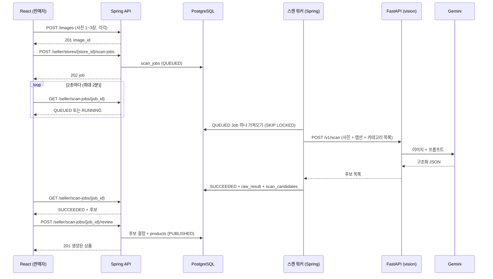

# BOZOR API 명세 v1

- 작성일: 2026-10-11
- 근거: [ERD](02-erd.md), [현지 조사](01-tajikistan-research.md), [임시 결정 목록](00-temporary-decisions.md)
- **구현 완료(2026-10-11).** 구현하면서 바뀐 점은 [10장](#10-구현하면서-바뀐-점)에 모았고 본문에도 반영했다.
- 실제 동작의 기준은 코드다. 백엔드를 띄우면 `http://localhost:8080/swagger-ui.html`에서 코드로 만든 API 문서를 볼 수 있다. 이 문서는 흐름과 규칙 설명용이다.

## 1. 공통 규칙

| 항목 | 규칙 |
|---|---|
| 기본 주소 | `/api/v1` (아래 경로는 모두 이 뒤에 붙는다) |
| 형식 | 요청·응답 모두 JSON, 필드 이름은 `snake_case` (DB·FastAPI와 동일). 사진 업로드만 `multipart/form-data` |
| 쿼리 파라미터 | 이름도 `snake_case` (`?category_id=3&market_id=1`) |
| ID | 숫자(`bigint`). 공개 상점 주소는 `slug` 사용 |
| 시각 | ISO 8601, UTC (`2026-10-12T05:30:00Z`). 화면 표시는 프런트에서 현지 시각(Asia/Dushanbe, UTC+5)으로 변환 |
| 금액 | 숫자, 소수점 2자리까지 (`45.00` → `45`도 허용). 통화는 항상 `currency` 필드로 함께 보냄 (`TJS`) |
| 수량 | 숫자, 소수점 3자리까지. `PIECE`·`SET` 단위는 정수만 허용 |
| 언어 | 공개 조회 API는 `?locale=ko` 처럼 받는다. 없으면 앱 기본 언어(`app.default-locale`, 현재 `ko`). 해당 언어 번역이 없으면 기본 언어 → 아무 번역 순으로 대체하고, 실제로 쓴 언어를 응답의 `locale`에 담는다 |
| 페이지 | `?page=0&size=20` (0부터 시작, `size` 최대 50). 응답은 아래 `Page` 형식 |
| 인증 | `Authorization: Bearer <access_token>` (JWT). 아래 [2. 인증](#2-인증-목-로그인) 참고 |
| 예시 값 | 이 문서 예시의 id·금액·시각은 설명용이다. 카테고리 id 등 실제 값은 DB 기준 |

**Page 응답 형식**

```json
{
  "items": [],
  "page": 0,
  "size": 20,
  "total_elements": 0,
  "total_pages": 0
}
```

### 값 목록

ERD의 CHECK 제약과 같다. Java에서는 같은 이름의 enum으로 만든다.

| 필드 | 값 |
|---|---|
| `locale`, `output_locale` | `tg`, `ru`, `en`, `ko` |
| `role` | `USER`, `ADMIN` |
| 상점 `template` | `GRID`(진열대형), `LIST`(가격표형), `SHOWCASE`(공방형) |
| 상점 `status` | `DRAFT`, `ACTIVE`, `HIDDEN` |
| 상품 `status` | `DRAFT`, `PUBLISHED`, `HIDDEN`, `ARCHIVED` |
| `price_type` | `FIXED`(정가), `NEGOTIABLE`(흥정 가능) |
| `unit`, `default_unit` | `PIECE`(개), `KG`, `LITER`, `METER`, `SET`(세트) |
| 스캔 `source_type` | `CAMERA`, `UPLOAD`, `SNS_IMPORT` |
| 스캔 `status` | `QUEUED`, `RUNNING`, `SUCCEEDED`, `FAILED` |
| 후보 `origin` | `AI`(AI 제안), `SELLER`(AI가 놓쳐 판매자가 추가) |
| 후보 `decision` | `PENDING`, `ACCEPTED`, `REJECTED` |
| 주문 `status` | `REQUESTED`, `CONFIRMED`, `READY`, `COMPLETED`, `REJECTED`, `CANCELLED` |
| `fulfillment_type` | `PICKUP`(매장 픽업), `DELIVERY`(판매자 배송) |
| `payment_method` | `CASH`(대면·착불 현금), `TRANSFER`(지갑·QR 송금, 판매자가 확인) |

### 오류 응답

Spring Boot의 `ProblemDetail`(RFC 9457) 형식에 `code`와 `errors`를 더한다. 프런트는 **`code`로 분기**하고 `detail`은 화면에 그대로 보여준다. 메시지는 운영 언어(현재 한국어)로 쓴다.

```json
{
  "title": "입력값이 올바르지 않습니다",
  "status": 400,
  "code": "VALIDATION_FAILED",
  "detail": "상품 1개의 입력값을 확인해 주세요.",
  "errors": [
    { "field": "items[0].product.price", "message": "0 이상이어야 합니다." }
  ]
}
```

| HTTP | `code` | 언제 |
|---|---|---|
| 400 | `VALIDATION_FAILED` | 필수 값 누락, 형식·범위 오류 (`errors`에 필드별 사유) |
| 400 | `IMAGE_INVALID` | 이미지가 아니거나 읽을 수 없음, 지원하지 않는 형식 |
| 400 | `SCAN_REVIEW_INCOMPLETE` | 검수 제출 시 AI 후보 중 결정하지 않은 것이 있음 |
| 401 | `UNAUTHORIZED` | 토큰 없음·만료 |
| 403 | `FORBIDDEN` | 내 상점·내 주문이 아님, 관리자 아님 |
| 404 | `NOT_FOUND` | 없거나 공개되지 않은 대상 (남의 비공개 상점도 403이 아니라 404) |
| 409 | `STORE_SLUG_TAKEN` | 상점 주소(`slug`) 중복 |
| 409 | `STORE_CONTACT_REQUIRED` | 연락처 없이 상점을 공개(`ACTIVE`)하려 함 |
| 409 | `PRODUCT_PRICE_REQUIRED` | 가격 없이 상품을 발행하려 함 |
| 409 | `PRODUCT_STATUS_INVALID` | 허용되지 않는 상품 상태 변경 (예: `ARCHIVED` → `PUBLISHED`) |
| 409 | `PRODUCT_NOT_DELETABLE` | `DRAFT`가 아닌 상품 삭제 시도 (`ARCHIVED`로 보관) |
| 409 | `SCAN_JOB_NOT_REVIEWABLE` | 분석이 끝나지 않은(`SUCCEEDED`가 아닌) 스캔을 검수하려 함 |
| 409 | `SCAN_JOB_ALREADY_REVIEWED` | 이미 검수한 스캔을 다시 제출 |
| 409 | `SCAN_JOB_NOT_RETRYABLE` | `FAILED`가 아닌 스캔을 재시도 |
| 409 | `IMPORT_BATCH_ALREADY_SUBMITTED` | 이미 분석을 요청한 일괄 등록 묶음에 다시 요청 |
| 409 | `ORDER_ITEM_UNAVAILABLE` | 주문 상품이 미발행·품절·다른 상점 상품이거나 재고보다 많음 |
| 409 | `ORDER_STATUS_INVALID` | 허용되지 않는 주문 상태 변경 |
| 413 | `IMAGE_TOO_LARGE` | 사진 5MB 초과 |
| 502 | `AI_BAD_RESPONSE` | (번역 등 바로 답하는 AI 기능) AI가 고칠 수 없는 오류·형식이 틀린 응답을 줌 |
| 503 | `AI_UNAVAILABLE` | (번역 등 바로 답하는 AI 기능) 요청 한도·과부하·시간 초과·AI 서버 꺼짐. 잠시 뒤 다시 하면 된다 |

## 2. 인증 (목 로그인)

**지금(임시)**: dev 프로필에서만 열리는 목 로그인 API로 시드 사용자를 골라 토큰을 받는다. 비밀번호는 없다.
**실증 전**: 실제 로그인 API(`/auth/...`)를 추가하고 `/dev/*`를 없앤다. **실제 로그인도 같은 형식의 토큰을 발급**하도록 만들어서, 나머지 API와 프런트 코드는 그대로 둔다. → [임시 결정 #1](00-temporary-decisions.md)

- 토큰: HS256 JWT, `sub` = 사용자 id, `role` = `USER`|`ADMIN`. 목 단계에서는 유효기간 7일, 리프레시 토큰 없음(임시 결정 #8).
- 권한 단계: **없음**(누구나) / **로그인** / **상점 주인**(`/seller/**`, 서비스에서 소유자 확인) / **주문자** / **관리자**(`role=ADMIN`).

## 3. 엔드포인트 한눈에 보기

| # | 메서드 | 경로 | 권한 | 설명 | 주차 |
|---|---|---|---|---|---|
| 1 | GET | `/dev/users` | 없음 (dev 전용) | 목 로그인용 사용자 목록 | 7 |
| 2 | POST | `/dev/login` | 없음 (dev 전용) | 사용자 id로 토큰 발급 | 7 |
| 3 | GET | `/me` | 로그인 | 내 정보 | 7 |
| 4 | PUT | `/me` | 로그인 | 이름·언어 변경 | 7 |
| 5 | GET | `/categories` | 없음 | 카테고리 트리 | 7 |
| 6 | GET | `/markets` | 없음 | 시장 목록 | 7 |
| 7 | POST | `/images` | 로그인 | 사진 업로드 | 7 |
| 8 | GET | `/images/{image_id}/file` | 없음(공개 사진) 또는 서명 | 사진 파일 (`?size=thumb`) | 7 |
| 9 | GET | `/seller/stores` | 로그인 | 내 상점 목록 | 7 |
| 10 | POST | `/seller/stores` | 로그인 | 상점 만들기 | 7 |
| 11 | GET | `/seller/stores/{store_id}` | 상점 주인 | 내 상점 상세 | 7 |
| 12 | PUT | `/seller/stores/{store_id}` | 상점 주인 | 상점 설정 저장 (전체 교체) | 7 |
| 13 | POST | `/seller/stores/{store_id}/status` | 상점 주인 | 공개·숨김 | 7 |
| 14 | POST | `/seller/stores/{store_id}/scan-jobs` | 상점 주인 | AI 스캔 요청 (202) | 8 |
| 15 | GET | `/seller/stores/{store_id}/scan-jobs` | 상점 주인 | 스캔 목록 (검수 대기함) | 8 |
| 16 | GET | `/seller/scan-jobs/{job_id}` | 상점 주인 | 스캔 상태·후보 (폴링) | 8 |
| 17 | POST | `/seller/scan-jobs/{job_id}/retry` | 상점 주인 | 실패한 스캔 재시도 | 8 |
| 18 | POST | `/seller/scan-jobs/{job_id}/review` | 상점 주인 | 검수 확정 → 상품 생성 | 8 |
| 19 | GET | `/seller/stores/{store_id}/products` | 상점 주인 | 내 상품 목록 (모든 상태) | 8 |
| 20 | POST | `/seller/stores/{store_id}/products` | 상점 주인 | 상품 직접 등록 | 8 |
| 21 | GET | `/seller/products/{product_id}` | 상점 주인 | 내 상품 상세 | 8 |
| 22 | PUT | `/seller/products/{product_id}` | 상점 주인 | 상품 수정 폼 저장 (전체 교체) | 8 |
| 23 | POST | `/seller/products/{product_id}/status` | 상점 주인 | 발행·숨김·보관 | 8 |
| 24 | POST | `/seller/products/{product_id}/stock` | 상점 주인 | 재고 수정 (판매자 직접 관리) | 8 |
| 25 | DELETE | `/seller/products/{product_id}` | 상점 주인 | 직접 등록한 초안 삭제 | 8 |
| 26 | GET | `/stores` | 없음 | 공개 상점 목록 | 9 |
| 27 | GET | `/stores/{slug}` | 없음 | 상점 화면 (템플릿 정보 포함) | 9 |
| 28 | GET | `/stores/{slug}/products` | 없음 | 상점의 발행 상품 | 9 |
| 29 | GET | `/products` | 없음 | 상품 검색·필터 | 9 |
| 30 | GET | `/products/{product_id}` | 없음 | 상품 상세 | 9 |
| 31 | POST | `/orders` | 로그인 | 주문하기 | 10 |
| 32 | GET | `/orders` | 로그인 | 내 주문 목록 | 10 |
| 33 | GET | `/orders/{order_id}` | 주문자 | 주문 상세 | 10 |
| 34 | POST | `/orders/{order_id}/cancel` | 주문자 | 주문 취소 | 10 |
| 35 | GET | `/seller/stores/{store_id}/orders` | 상점 주인 | 받은 주문 목록 | 10 |
| 36 | GET | `/seller/orders/{order_id}` | 상점 주인 | 받은 주문 상세 | 10 |
| 37 | POST | `/seller/orders/{order_id}/status` | 상점 주인 | 접수(재고 빼기 선택)·준비 완료·거래 완료·거절 | 10 |
| 38 | GET | `/admin/metrics/scan` | 관리자 | 2차 회의 검증 지표 | 10 |
| 39 | POST | `/seller/stores/{store_id}/import-batches` | 상점 주인 | SNS 일괄 등록 시작 (온보딩 시각 기록) | 11 |
| 40 | POST | `/seller/import-batches/{batch_id}/jobs` | 상점 주인 | 게시물별 AI 스캔 요청 (202) | 11 |
| 41 | GET | `/seller/import-batches/{batch_id}` | 상점 주인 | 일괄 등록 진행 상황 (폴링) | 11 |
| 42 | POST | `/seller/products/{product_id}/translations/auto` | 상점 주인 | AI 번역 초안(타직어·러시아어·영어) | 12 |

주차는 수정 일정 기준이다.

| 주차 | 기간 | 범위 |
|---|---|---|
| 7주차 | 10/12~18 | 기반: 목 로그인, 기준 데이터, 사진, 상점 |
| 8주차 | 10/19~25 | 핵심 흐름: 스캔 → 검수 → 발행, 판매자 상품 관리 |
| 9주차 | 10/26~11/1 | 구매자 조회·검색 |
| 10주차 | 11/2~8 | 주문, 지표, 통합 데모 1차 |
| 11주차 | 11/9~15 | 추가 기능: SNS 사진 일괄 등록(39~41, 2026-10-12 먼저 구현) |
| 12주차 | 11/16~22 | 추가 기능: 다국어 상품 정보(42, 2026-10-12 먼저 구현), 배포 |

## 4. 핵심 흐름: 사진 → 상품 발행



- 워커는 Spring 안의 `@Scheduled` 작업으로 시작한다(별도 서버 없음). 1초마다 `status = 'QUEUED' AND available_at <= now()`인 Job을 하나씩 가져간다.
- 2분이 지나도 끝나지 않으면 화면은 "검수 대기함에서 나중에 확인"으로 안내하고 폴링을 멈춘다. Job은 계속 진행된다.
- 진행 중 응답에는 `Retry-After: 2` 헤더를 붙인다.

## 5. 상세

### 5.1 인증·내 정보

#### `GET /dev/users`

dev 프로필에서만 존재한다(그 밖에서는 404). 로그인 화면의 "사용자 고르기" 목록용이다.

```json
[
  { "id": 1, "display_name": "판매자 파르호드", "role": "USER", "store_slugs": ["farhod-dried-fruit"] },
  { "id": 4, "display_name": "구매자 마디나", "role": "USER", "store_slugs": [] },
  { "id": 6, "display_name": "관리자", "role": "ADMIN", "store_slugs": [] }
]
```

#### `POST /dev/login`

요청

```json
{ "user_id": 1 }
```

응답 200

```json
{
  "access_token": "eyJhbGciOiJIUzI1NiJ9.example.signature",
  "token_type": "Bearer",
  "expires_in": 604800,
  "user": { "id": 1, "display_name": "판매자 파르호드", "locale": "ko", "role": "USER" }
}
```

#### `GET /me`

응답 200

```json
{
  "id": 1,
  "phone_number": "+992000000001",
  "display_name": "판매자 파르호드",
  "locale": "ko",
  "role": "USER",
  "stores": [ { "id": 1, "slug": "farhod-dried-fruit", "name": "파르호드 말린 과일", "status": "ACTIVE" } ]
}
```

#### `PUT /me`

이름과 언어를 둘 다 보낸다(화면의 폼 전체를 저장). `locale`은 `tg`|`ru`|`en`|`ko`.

```json
{ "display_name": "파르호드", "locale": "ko" }
```

응답 200: `GET /me`와 같은 형식.

### 5.2 기준 데이터

#### `GET /categories`

2단계 트리를 한 번에 준다. 상품을 등록할 때는 **말단(`children`가 빈 항목)만 고를 수 있다.** `default_unit`은 단위 자동 제안용이다.

```json
[
  {
    "id": 1, "code": "food", "name": "식품", "default_unit": null,
    "children": [
      { "id": 10, "code": "food.dried_fruit", "name": "말린 과일", "default_unit": "KG", "children": [] },
      { "id": 19, "code": "food.etc", "name": "기타 식품", "default_unit": "PIECE", "children": [] }
    ]
  },
  { "id": 9, "code": "other", "name": "기타", "default_unit": "PIECE", "children": [] }
]
```

#### `GET /markets`

```json
[
  { "id": 1, "name": "Меҳргон", "city": "Душанбе" },
  { "id": 2, "name": "Корвон", "city": "Душанбе" }
]
```

### 5.3 사진

#### `POST /images`

`multipart/form-data`, 필드 이름 `file`. JPEG·PNG·WEBP, 최대 5MB. **프런트는 업로드 전에 긴 변을 2048px 이하로 줄인다**(느린 회선 대응, 조사 §1).

서버 처리 순서: 실제 이미지인지 확인 → 방향 보정 → **EXIF 제거** → 긴 변 2048px JPEG로 저장 → 400px 썸네일 생성. 같은 사용자가 같은 파일(원본 SHA-256 동일)을 다시 올리면 새로 저장하지 않고 기존 사진을 200으로 돌려준다(`duplicate: true`).

응답 201 (중복이면 200)

```json
{
  "id": 55,
  "url": "/api/v1/images/55/file?exp=1792400400&sig=Xk3…",
  "thumbnail_url": "/api/v1/images/55/file?size=thumb&exp=1792400400&sig=Xk3…",
  "width": 2048,
  "height": 1536,
  "duplicate": false
}
```

#### `GET /images/{image_id}/file`

`?size=thumb`이면 썸네일. 응답은 이미지 바이트. 아래 둘 중 하나일 때만 내주고, 그 밖에는 **404**(사진이 있는지도 알리지 않음)(임시 결정 #9).

| 경우 | 주소 | 캐시 |
|---|---|---|
| **공개 사진**: 판매 중(`PUBLISHED`) 상품이 공개(`ACTIVE`) 상점에 있거나, 공개 상점의 로고·배너 | 서명 없는 주소 (구매자용 응답: 상품·상점 공개 API) | `max-age=86400, public` |
| **서명 주소**: 주인에게 준 응답(업로드 결과, 판매자 상품·스캔 작업·상점 응답)에 들어 있는 `exp`·`sig` | `?exp=<만료 시각(초)>&sig=<서명>` | `max-age=3600, private` |

- 서명은 HMAC-SHA256(`"image:{id}:{exp}"`). 만료 시각을 1시간 단위로 맞춰서, 2초 폴링 중에도 주소가 바뀌지 않아 브라우저 캐시가 유지된다. 서명 주소는 발급 후 1~2시간 유효하다.
- `` 태그는 로그인 토큰을 보낼 수 없어서 토큰 대신 서명을 쓴다. S3로 바꿔도 같은 "서명 URL" 방식이라 화면은 그대로다.
- 판매자 화면에서는 숨긴 상품·비공개 상점의 사진도 서명 주소로 계속 보인다. 상품을 숨기면 서명 없는 주소는 바로 404가 되지만, 이미 받아 간 브라우저·중간 캐시에는 최대 하루 남을 수 있다.
- **프런트는 경로를 직접 조립하지 말고 항상 응답의 `url`을 쓴다.** 서명 없는 주소로 바꿔 쓰면 비공개 사진은 보이지 않는다.

### 5.4 판매자: 상점

#### `GET /seller/stores`

내 상점 목록. 응답은 아래 `Store` 배열.

#### `POST /seller/stores`

`slug`를 비우면 서버가 `store-{id}`로 만든다. 새 상점은 `DRAFT` 상태다.

```json
{
  "name": "파르호드 말린 과일",
  "slug": "farhod-dried-fruit",
  "description": "판자켄트 살구와 건포도를 직접 말려 팝니다.",
  "template": "GRID",
  "theme_color": "#C2410C",
  "market_id": 1,
  "location_detail": "3열 12번",
  "address_text": null,
  "landmark": null,
  "contact_phone": null,
  "whatsapp_phone": "+992000000001",
  "instagram_handle": "farhod.mewa",
  "telegram_username": null
}
```

응답 201: `Store`

```json
{
  "id": 1,
  "slug": "farhod-dried-fruit",
  "name": "파르호드 말린 과일",
  "description": "판자켄트 살구와 건포도를 직접 말려 팝니다.",
  "template": "GRID",
  "theme_color": "#C2410C",
  "logo": null,
  "banner": null,
  "market": { "id": 1, "name": "Меҳргон" },
  "location_detail": "3열 12번",
  "address_text": null,
  "landmark": null,
  "contact_phone": null,
  "whatsapp_phone": "+992000000001",
  "instagram_handle": "farhod.mewa",
  "telegram_username": null,
  "status": "DRAFT",
  "created_at": "2026-10-12T05:30:00Z",
  "updated_at": "2026-10-12T05:30:00Z"
}
```

#### `GET /seller/stores/{store_id}`

응답 200: `Store`.

#### `PUT /seller/stores/{store_id}`

상점 설정 폼 전체를 저장한다(요청 형식은 `POST /seller/stores`와 같다). **전체 교체라서 보내지 않거나 `null`로 보낸 값은 지워진다.** 로고·배너는 업로드한 사진 id로 지정하고(`logo_image_id`, `banner_image_id`), 지우려면 `null`을 보낸다. `slug`만은 비우면 기존 주소를 유지한다. 공개 중인 상점에서 연락처를 모두 지우면 `STORE_CONTACT_REQUIRED`.

응답 200: `Store`.

#### `POST /seller/stores/{store_id}/status`

```json
{ "status": "ACTIVE" }
```

`ACTIVE`(공개) 또는 `HIDDEN`(숨김). **`ACTIVE`로 바꾸려면 `whatsapp_phone` 또는 `contact_phone`이 있어야 한다**(`STORE_CONTACT_REQUIRED`). 구매자가 연락할 수단 없이 공개되는 것을 막기 위해서다. 응답 200: `Store`.

### 5.5 판매자: AI 스캔과 검수

#### `POST /seller/stores/{store_id}/scan-jobs`

먼저 `POST /images`로 올린 사진 id를 1~3개 보낸다. `output_locale`을 비우면 앱 기본 언어를 쓴다.

```json
{
  "image_ids": [55, 56],
  "source_type": "SNS_IMPORT",
  "caption_text": "Курага 45 сомони/кг. Доставка по Душанбе.",
  "output_locale": "ko"
}
```

- `source_type`: `CAMERA`(앱에서 촬영) | `UPLOAD`(갤러리) | `SNS_IMPORT`(저장해 둔 SNS 게시물 사진·캡션)
- `caption_text`가 있으면 AI는 **캡션에 적힌 가격만** `suggested_price`로 뽑는다. 사진만 보고 가격을 추측하지 않는다.

응답 **202**: `ScanJob` (`status: "QUEUED"`, `candidates: []`)

#### `GET /seller/stores/{store_id}/scan-jobs`

`?status=SUCCEEDED&reviewed=false`로 검수 대기함을 만든다. 응답은 `Page<ScanJob>`이고, 목록에서는 `candidates`를 빼고 `candidate_count`만 준다.

#### `GET /seller/scan-jobs/{job_id}`

폴링용. 응답 200: `ScanJob`

```json
{
  "id": 31,
  "store_id": 1,
  "import_batch_id": null,
  "status": "SUCCEEDED",
  "source_type": "SNS_IMPORT",
  "caption_text": "Курага 45 сомони/кг. Доставка по Душанбе.",
  "output_locale": "ko",
  "images": [
    { "id": 55, "url": "/api/v1/images/55/file?exp=1792400400&sig=Xk3…", "thumbnail_url": "/api/v1/images/55/file?size=thumb&exp=1792400400&sig=Xk3…", "width": 2048, "height": 1536 }
  ],
  "attempt_count": 1,
  "available_at": "2026-10-19T06:00:00Z",
  "model": "gemini-3.5-flash",
  "prompt_version": "product_scan_v3",
  "elapsed_ms": 4200,
  "error": null,
  "image_notes": ["사진 오른쪽 아래 상품은 일부만 보여 후보에서 제외했습니다."],
  "candidate_count": 2,
  "candidates": [
    {
      "id": 101,
      "candidate_index": 0,
      "origin": "AI",
      "name": "말린 살구",
      "description": "주황색 말린 살구가 쟁반에 쌓여 있습니다.",
      "category": { "id": 10, "code": "food.dried_fruit", "name": "말린 과일", "default_unit": "KG" },
      "visible_text": [],
      "review_notes": ["씨 제거 여부는 사진으로 확인할 수 없습니다."],
      "suggested_price": 45,
      "decision": "PENDING",
      "product_id": null
    },
    {
      "id": 102,
      "candidate_index": 1,
      "origin": "AI",
      "name": "비닐 봉투",
      "description": "투명한 비닐 봉투가 보입니다.",
      "category": { "id": 40, "code": "household.etc", "name": "기타 생활용품", "default_unit": "PIECE" },
      "visible_text": [],
      "review_notes": [],
      "suggested_price": null,
      "decision": "PENDING",
      "product_id": null
    }
  ],
  "created_at": "2026-10-19T06:00:00Z",
  "finished_at": "2026-10-19T06:00:05Z",
  "reviewed_at": null
}
```

후보의 `product_id`는 검수 후 그 후보로 만든 상품 id다(거절했으면 `null`). 실패하면 `status: "FAILED"`이고 `error`에 사유가 들어간다. `raw_result`(AI 원본)는 API로 내보내지 않는다. 지표용으로 DB에만 보관한다.

```json
{ "code": "AI_RATE_LIMITED", "message": "AI 요청 한도에 도달했습니다. 잠시 후 다시 시도해 주세요." }
```

| `error.code` | 의미 | 워커 처리 |
|---|---|---|
| `AI_RATE_LIMITED` | Gemini 429 | 재시도 |
| `AI_TIMEOUT` | Gemini·FastAPI 응답 시간 초과 | 재시도 |
| `AI_UNAVAILABLE` | FastAPI 연결 실패·503 (Gemini 과부하 500·503 포함) | 재시도 |
| `AI_BAD_RESPONSE` | AI 응답이 스키마와 맞지 않음 (502) | 바로 실패 |
| `IMAGE_INVALID` | FastAPI가 사진을 읽지 못함 (400·413) | 바로 실패 |

**최대 3번 시도한다.** 1번째 실패 후 30초, 2번째 실패 후 60초 뒤로 `available_at`을 미루고, 3번째도 실패하면 `FAILED`로 바꾼다. 기다리는 동안에는 `status`가 `QUEUED`이고 `error`에 직전 실패 사유가 남아 있어서, 화면에 "잠시 후 다시 시도합니다"를 보여줄 수 있다.

#### `POST /seller/scan-jobs/{job_id}/retry`

`FAILED`인 Job만 `QUEUED`로 되돌린다(`SCAN_JOB_NOT_RETRYABLE`). 응답 202: `ScanJob`.

#### `POST /seller/scan-jobs/{job_id}/review`

검수를 **한 번에 확정**하는 API다. 하나의 트랜잭션으로 처리한다.

규칙
- **AI 후보는 모두 한 번씩** `ACCEPTED` 또는 `REJECTED`로 결정해야 한다. 빠진 것이 있으면 `SCAN_REVIEW_INCOMPLETE`. 지표 계산에서 `PENDING`이 남지 않게 하기 위해서다.
- `candidate_id: null`은 **AI가 놓친 상품**이다. `origin=SELLER` 후보와 상품을 함께 만든다(재현율 계산용).
- `ACCEPTED`에는 `product`가 필요하다. `image_ids`를 비우면 스캔 사진을 그대로 쓰고, `unit`을 비우면 카테고리 기본 단위를 쓴다.
- `publish: true`면 상품을 바로 `PUBLISHED`로 만든다. 이때는 모든 상품에 가격이 있어야 한다(`PRODUCT_PRICE_REQUIRED`). `false`면 `DRAFT`로 만든다.
- `SUCCEEDED`가 아니면 `SCAN_JOB_NOT_REVIEWABLE`, 이미 검수했으면 `SCAN_JOB_ALREADY_REVIEWED`.
- AI 후보가 0개이고 판매자도 추가하지 않으면 `items: []`로 **상품 없이** 검수를 끝낸다(가게 전경처럼 상품이 없는 SNS 사진). AI 후보가 있으면 빈 `items`는 `SCAN_REVIEW_INCOMPLETE`.

요청

```json
{
  "publish": true,
  "items": [
    {
      "candidate_id": 101,
      "decision": "ACCEPTED",
      "product": {
        "category_id": 10,
        "translations": [ { "locale": "ko", "name": "말린 살구(쿠라가)", "description": "씨를 뺀 판자켄트산 말린 살구." } ],
        "price": 45,
        "price_type": "NEGOTIABLE",
        "unit": "KG",
        "stock_quantity": 120,
        "image_ids": [55]
      }
    },
    { "candidate_id": 102, "decision": "REJECTED" },
    {
      "candidate_id": null,
      "decision": "ACCEPTED",
      "product": {
        "category_id": 11,
        "translations": [ { "locale": "ko", "name": "아몬드", "description": null } ],
        "price": 70,
        "price_type": "FIXED"
      }
    }
  ]
}
```

응답 201

```json
{
  "scan_job_id": 31,
  "reviewed_at": "2026-10-19T06:00:25Z",
  "products": [
    { "id": 7, "status": "PUBLISHED", "name": "말린 살구(쿠라가)", "price": 45, "currency": "TJS", "unit": "KG" },
    { "id": 8, "status": "PUBLISHED", "name": "아몬드", "price": 70, "currency": "TJS", "unit": "KG" }
  ]
}
```

#### SNS 사진 일괄 등록 (`/import-batches`)

2차 회의 추가 기능 "기존 SNS 이미지 일괄 등록"과 지표 "상점 온보딩 소요시간(이미지 20장 기준 5분 이내)"을 위한 API다. AI 처리·검수는 위 스캔 API를 그대로 쓴다.

1. `POST /seller/stores/{store_id}/import-batches` — **사진을 고르자마자(업로드 전)** 부른다. 응답 201: `ImportBatch`. 이 `created_at`이 온보딩 시작 시각이다(서버 시각).
2. `POST /images`로 사진을 올린다.
3. `POST /seller/import-batches/{batch_id}/jobs` — 게시물마다 `SNS_IMPORT` 스캔 작업을 하나씩 만든다. 응답 202: `ImportBatch`.

```json
{
  "output_locale": "ko",
  "items": [
    { "image_ids": [55], "caption_text": "Курага 45 сомони/кг" },
    { "image_ids": [56, 57], "caption_text": null }
  ]
}
```

- 게시물 1~20개(근거: 지표 "20장 기준", 무료 AI 키 한도 임시 결정 #7), 게시물마다 사진 1~3장(단건 스캔과 같은 규칙).
- 같은 사진이 두 게시물에 들어 있으면 400(`items[i].image_ids`). 같은 상품이 두 번 만들어지기 때문이다.
- 한 묶음은 한 번만 요청할 수 있다(`IMPORT_BATCH_ALREADY_SUBMITTED`).
- 워커는 **단건 스캔을 일괄 등록 작업보다 먼저** 처리한다. 단건은 판매자가 화면에서 기다리고(지표 "1건 30초"), 일괄 등록은 끝난 것부터 차례로 검수하기 때문이다.

4. `GET /seller/import-batches/{batch_id}` — 진행 상황. 분석 중인 게시물이 있으면 `Retry-After: 2`. 끝난 게시물부터 `/seller/scan-jobs/{job_id}/review`로 검수한다.

응답: `ImportBatch`

```json
{
  "id": 3,
  "store_id": 1,
  "created_at": "2026-11-10T06:00:00Z",
  "submitted_at": "2026-11-10T06:01:10Z",
  "progress": { "posts": 2, "images": 3, "in_progress": 0, "succeeded": 2, "failed": 0, "reviewed": 2 },
  "completed_at": "2026-11-10T06:03:40Z",
  "onboarding_seconds": 220,
  "jobs": [ { "id": 41, "import_batch_id": 3, "status": "SUCCEEDED", "source_type": "SNS_IMPORT", "...": "ScanJob 목록 형식(candidates 제외)" } ]
}
```

- `completed_at`: **모든 게시물을 검수한** 시각(마지막 검수 시각). 실패한 게시물이 남아 있으면 다시 시도해서 검수해야 끝난다.
- `onboarding_seconds` = `created_at` → `completed_at`. 위 숫자는 형식 예시다.

### 5.6 판매자: 상품

`ProductInput`은 위 검수 요청의 `product`와 같은 형식이다. `translations`에는 최소 1개 언어가 필요하다. 판매자가 쓰는 언어는 지금 `ko`이고(임시 결정 #2), 다른 언어는 아래 AI 번역 초안으로 채울 수 있다.

**`is_auto_translated`(판매자가 확인하지 않은 AI 번역) 규칙** — 가격만 고쳐 저장해도 기계 번역이 "확인됨"으로 바뀌지 않게 서버가 정한다.
- `translations[].is_auto_translated`는 보통 비워 보낸다. 기존 자동 번역과 **글이 같으면 그대로 자동 번역**, 고쳤거나 새로 쓴 번역은 판매자 확인(`false`).
- 고치지 않고 확인만 하려면 그 번역에 `"is_auto_translated": false`를 보낸다. `true`를 보내도 판매자가 쓴 번역을 자동 번역으로 바꾸지는 않는다.

#### `GET /seller/stores/{store_id}/products`

`?status=DRAFT&page=0`. 응답은 `Page<SellerProduct>`.

#### `POST /seller/stores/{store_id}/products`

AI를 거치지 않는 직접 등록이다(`source: null`). 요청은 `ProductInput`이고 `DRAFT`로 만든다. 응답 201: `SellerProduct`.

#### `GET /seller/products/{product_id}`

응답 200: `SellerProduct`

```json
{
  "id": 7,
  "store_id": 1,
  "status": "PUBLISHED",
  "category": { "id": 10, "code": "food.dried_fruit", "name": "말린 과일", "default_unit": "KG" },
  "price": 45,
  "currency": "TJS",
  "price_type": "NEGOTIABLE",
  "unit": "KG",
  "stock_quantity": 120,
  "translations": [
    { "locale": "ko", "name": "말린 살구(쿠라가)", "description": "씨를 뺀 판자켄트산 말린 살구.", "is_auto_translated": false }
  ],
  "images": [
    { "id": 55, "url": "/api/v1/images/55/file?exp=1792400400&sig=Xk3…", "thumbnail_url": "/api/v1/images/55/file?size=thumb&exp=1792400400&sig=Xk3…", "width": 2048, "height": 1536 }
  ],
  "source": { "scan_job_id": 31, "candidate_id": 101 },
  "published_at": "2026-10-19T06:00:25Z",
  "created_at": "2026-10-19T06:00:25Z",
  "updated_at": "2026-10-19T06:00:25Z"
}
```

#### `PUT /seller/products/{product_id}`

상품 수정 폼 전체를 저장한다(요청은 `ProductInput`). **전체 교체라서 `translations`에 없는 언어는 지워지고**, `image_ids`는 보낸 순서대로 바뀐다(첫 번째가 대표 사진). 화면은 불러온 번역을 모두 다시 보내야 한다. 판매 중인 상품의 가격을 비우면 `PRODUCT_PRICE_REQUIRED`. 상태와 재고는 아래의 전용 API로 바꾼다. 응답 200: `SellerProduct`.

#### `POST /seller/products/{product_id}/translations/auto`

2차 회의 추가 기능 "다국어 상품 정보(타직어·러시아어·영어)". 판매자가 쓴 상품명·설명(원문)을 AI로 번역해 `is_auto_translated: true`로 저장한다. 응답 200: `SellerProduct`.

```json
{ "locales": ["tg", "ru", "en"] }
```

- 본문을 비우면 `tg`·`ru`·`en`. 원문 = 판매자가 쓴 번역 중 앱 기본 언어(없으면 언어 코드 순 첫 번째).
- **판매자가 쓴 번역(`is_auto_translated: false`)은 덮어쓰지 않는다.** 대상 언어가 모두 판매자가 쓴 것이면 400(`locales`).
- 판매자가 누를 때만 AI를 부른다(상품 하나에 호출 1번, 무료 키 한도 임시 결정 #7). 실제 호출 1번에 약 10초 걸렸다(2026-10-12).
- 화면은 원문을 고친 뒤 저장하지 않았으면 이 버튼을 막는다(서버는 저장된 원문을 번역한다). 번역하는 동안 원문이 바뀌면 400(`translations`).
- AI 오류: 요청 한도·과부하·시간 초과는 `AI_UNAVAILABLE`(503), 고칠 수 없는 오류는 `AI_BAD_RESPONSE`(502).
- **타직어 번역 품질은 아직 검증하지 않았다.** 필로·현지 검수가 필요하다(조사 §2).

#### `POST /seller/products/{product_id}/status`

```json
{ "status": "PUBLISHED" }
```

발행·숨김·보관. 아래 [상태 전이](#6-상태-전이) 규칙을 따르고, 발행하려면 가격이 있어야 한다. 응답 200: `SellerProduct`.

#### `POST /seller/products/{product_id}/stock`

```json
{ "stock_quantity": 95 }
```

**재고는 판매자가 직접 관리한다.** `null`이면 "재고 관리 안 함"(항상 구매 가능), `0`이면 품절이다. 개수 단위(`PIECE`·`SET`)는 정수만 받는다. 목록 화면의 [−][+] 버튼이 이 API를 부른다. 응답 200: `SellerProduct`.

#### `DELETE /seller/products/{product_id}`

**직접 등록한 `DRAFT`만** 지울 수 있다. 응답 204. 발행된 적이 있는 상품은 주문 기록이 참조하고, AI 검수로 만든 초안은 지표용 "후보 → 상품" 연결이 있어서 지우지 않고 `ARCHIVED`로 보관한다(`PRODUCT_NOT_DELETABLE`).

### 5.7 구매자: 상점·상품 조회

공개 API는 **`ACTIVE` 상점의 `PUBLISHED` 상품만** 보여준다. 그 밖은 404.

#### `GET /stores`

`?market_id=1&q=살구&page=0`. 응답은 `Page<StoreSummary>`

```json
{
  "items": [
    { "slug": "farhod-dried-fruit", "name": "파르호드 말린 과일", "template": "GRID", "logo_url": null,
      "market": { "id": 1, "name": "Меҳргон" }, "location_detail": "3열 12번", "product_count": 3 }
  ],
  "page": 0, "size": 20, "total_elements": 1, "total_pages": 1
}
```

#### `GET /stores/{slug}`

상점 화면 하나를 그리는 데 필요한 정보를 한 번에 준다. `categories`는 이 상점에 실제로 있는 말단 카테고리와 상품 수다(필터 칩, 가격표형 템플릿의 묶음 제목).

```json
{
  "slug": "nilufar-atlas",
  "name": "닐루파르 아틀라스",
  "description": "아틀라스·아드라스 원단을 미터 단위로 재단해 드립니다.",
  "template": "LIST",
  "theme_color": "#7C3AED",
  "logo_url": null,
  "banner_url": null,
  "market": { "id": 2, "name": "Корвон" },
  "location_detail": "B동 41번",
  "address_text": null,
  "landmark": null,
  "contact": { "phone": null, "whatsapp_phone": "+992000000002", "instagram_handle": null, "telegram_username": null },
  "categories": [ { "id": 21, "code": "textiles.ikat", "name": "아틀라스·아드라스 원단", "product_count": 1 } ],
  "product_count": 1
}
```

#### `GET /stores/{slug}/products`

`?category_id=21&page=0&size=50`. 응답은 `Page<ProductSummary>`(아래 `GET /products`와 같은 항목 형식).

#### `GET /products`

| 파라미터 | 설명 |
|---|---|
| `q` | 검색어. 모든 언어의 상품명에서 `ILIKE '%q%'` 또는 trigram 유사도(`%`)로 찾는다 |
| `category_id` | 대분류 id면 그 아래 소분류까지 포함 |
| `market_id`, `store_slug` | 시장·상점으로 좁히기 |
| `sort` | `recent`(기본) \| `price_asc` \| `price_desc` \| `relevance`(`q`가 있을 때 기본) |
| `locale`, `page`, `size` | 공통 규칙 |

```json
{
  "items": [
    {
      "id": 7,
      "name": "말린 살구(쿠라가)",
      "locale": "ko",
      "price": 45,
      "currency": "TJS",
      "price_type": "NEGOTIABLE",
      "unit": "KG",
      "stock_quantity": 120,
      "thumbnail_url": "/api/v1/images/55/file?size=thumb",
      "category": { "id": 10, "code": "food.dried_fruit", "name": "말린 과일" },
      "store": { "id": 1, "slug": "farhod-dried-fruit", "name": "파르호드 말린 과일", "market_name": "Меҳргон" }
    }
  ],
  "page": 0, "size": 20, "total_elements": 1, "total_pages": 1
}
```

`stock_quantity`가 `null`이면 판매자가 재고를 관리하지 않는 것이고(구매 가능), `0`이면 품절이다.

#### `GET /products/{product_id}`

`ProductSummary`에 `description`, `images`(전체), 상점 위치(`store.location_detail`)와 연락처(`store.contact`)를 더한다. `store.id`는 장바구니에서 상점별로 주문을 나눌 때 쓴다.

`?locale=ru`처럼 언어를 고르면 그 언어 → 앱 기본 언어 → 아무 언어 순으로 번역 하나를 보여준다. 보여준 번역이 판매자가 확인하지 않은 AI 번역이면 `is_auto_translated: true`(화면에 "자동 번역" 안내). 자동 번역도 검색 대상이라 러시아어 이름으로도 찾을 수 있다.

### 5.8 주문

**한 주문 = 한 상점**이다. 여러 상점 상품을 담았다면 프런트가 상점별로 나눠서 주문을 여러 번 보낸다. 장바구니는 프런트(브라우저 저장소)에만 둔다.

#### `POST /orders`

```json
{
  "store_id": 1,
  "items": [ { "product_id": 7, "quantity": 1.5 }, { "product_id": 3, "quantity": 1 } ],
  "fulfillment_type": "PICKUP",
  "payment_method": "CASH",
  "contact_phone": null,
  "delivery_address": null,
  "landmark": null,
  "buyer_note": "토요일 오전에 가지러 갈게요."
}
```

서버 처리
- 상품이 모두 이 상점의 `PUBLISHED` 상품인지, 상점이 `ACTIVE`인지 확인한다. `PIECE`·`SET`은 정수 수량만 받고, 재고를 관리하는 상품은 재고보다 많이 주문할 수 없다(`ORDER_ITEM_UNAVAILABLE`).
- 상품명·단가·단위를 **스냅샷**으로 저장하고 합계를 계산한다.
- `contact_phone`을 비우면 내 전화번호를 쓴다. `DELIVERY`면 `delivery_address`가 필요하다.
- **재고는 자동으로 차감하지 않는다.** 판매자가 접수할 때 "재고에서 빼기"를 고른 경우만 뺀다(아래 `POST /seller/orders/{order_id}/status`).

응답 201: `Order`

```json
{
  "id": 1,
  "order_number": "BZ-261019-00001",
  "status": "REQUESTED",
  "store": { "id": 1, "slug": "farhod-dried-fruit", "name": "파르호드 말린 과일", "whatsapp_phone": "+992000000001" },
  "buyer": { "id": 4, "display_name": "구매자 마디나" },
  "items": [
    { "product_id": 7, "product_name": "말린 살구(쿠라가)", "unit_price": 45, "price_type": "NEGOTIABLE", "unit": "KG", "quantity": 1.5, "line_total": 67.5 },
    { "product_id": 3, "product_name": "호두", "unit_price": 60, "price_type": "NEGOTIABLE", "unit": "KG", "quantity": 1, "line_total": 60 }
  ],
  "total_amount": 127.5,
  "currency": "TJS",
  "is_estimate": true,
  "fulfillment_type": "PICKUP",
  "payment_method": "CASH",
  "contact_phone": "+992000000011",
  "delivery_address": null,
  "landmark": null,
  "buyer_note": "토요일 오전에 가지러 갈게요.",
  "stock_deducted": false,
  "created_at": "2026-10-19T07:00:00Z",
  "updated_at": "2026-10-19T07:00:00Z"
}
```

- `order_number`는 `BZ-{YYMMDD}-{id 5자리}`다. id가 유일하므로 따로 번호를 관리할 필요가 없다.
- `is_estimate`: 흥정 가능 상품이 하나라도 있으면 `true`. 화면에 "최종 금액은 판매자와 협의"라고 표시한다. 저장하지 않고 항목에서 계산하는 값이다.

#### `GET /orders`

내가 주문한 목록. `?status=`, 응답 `Page<Order>`.

#### `GET /orders/{order_id}`

응답 200: `Order`.

#### `POST /orders/{order_id}/cancel`

`REQUESTED`·`CONFIRMED`일 때만 가능하다. 응답 200: `Order`.

#### `GET /seller/stores/{store_id}/orders`

`?status=REQUESTED`로 새 주문함을 만든다. 응답 `Page<Order>`.

#### `GET /seller/orders/{order_id}`

응답 200: `Order`.

#### `POST /seller/orders/{order_id}/status`

```json
{ "status": "CONFIRMED", "deduct_stock": true }
```

응답 200: `Order`. 허용되는 변경은 아래 상태 전이 표를 따른다(`ORDER_STATUS_INVALID`).

- `deduct_stock`은 **접수(`CONFIRMED`)할 때만** 의미가 있다. `true`면 재고를 관리하는 상품의 재고에서 주문 수량을 뺀다(0 아래로는 내려가지 않고, 재고를 관리하지 않는 상품은 그대로). 화면은 접수 버튼을 누를 때 "재고에서 뺄까요?"를 한 번 묻는다.
- 재고를 뺀 주문이 나중에 취소되면 서버가 재고를 되돌린다(`stock_deducted`로 기억).

### 5.9 관리자: 지표

#### `GET /admin/metrics/scan`

2차 회의에서 정한 검증 지표를 [ERD의 지표 쿼리](02-erd.md#검증-지표-쿼리-2차-회의-지표)로 계산한다. `?from=2026-10-19&to=2026-11-08&prompt_version=product_scan_v3`로 기간·프롬프트 버전별 비교가 가능하다. 주간 보고서에 그대로 옮겨 쓸 수 있다.

```json
{
  "from": "2026-10-19",
  "to": "2026-11-08",
  "prompt_version": "product_scan_v3",
  "scan_jobs": { "total": 120, "succeeded": 114, "failed": 6, "median_elapsed_ms": 4800 },
  "candidates": { "ai_total": 180, "accepted": 141, "rejected": 39, "seller_added": 17 },
  "category_accuracy": { "leaf": 0.78, "top": 0.93 },
  "precision": 0.78,
  "recall": 0.89,
  "median_seconds_to_publish": 26.4,
  "onboarding": {
    "started": 6, "submitted": 5, "completed": 4,
    "median_seconds": 262, "median_prepare_seconds": 71,
    "recent": [ { "id": 3, "store_id": 1, "images": 20, "posts": 17, "published": 15, "seconds": 262, "prepare_seconds": 71 } ]
  },
  "targets": { "category_accuracy_leaf": 0.8, "seconds_to_publish": 30, "onboarding_seconds_for_20_images": 300 }
}
```

위 숫자는 형식 예시이고 실제 측정값이 아니다.

- `median_seconds_to_publish`는 **단건 스캔만** 센다. 일괄 등록 게시물은 앞 게시물 뒤에 줄 서므로 `onboarding`으로 따로 잰다.
- `onboarding`: 기간은 묶음 시작 시각 기준, 프롬프트 버전 필터는 적용하지 않는다. `started`(시작) / `submitted`(분석 요청) / `completed`(모든 게시물 검수). `median_prepare_seconds` = 시작 → 분석 요청(사진 업로드·캡션 입력). `recent`는 완료된 묶음 최근 20개. 목표가 "20장 기준"이라 묶음별 `images`를 함께 준다(20장으로 환산하지 않는다).

## 6. 상태 전이

**스캔 Job** (`scan_jobs.status`, 워커가 변경)

| 현재 | 다음 | 언제 |
|---|---|---|
| `QUEUED` | `RUNNING` | 워커가 가져감 (`attempt_count` + 1) |
| `RUNNING` | `SUCCEEDED` | 후보 저장 완료 |
| `RUNNING` | `QUEUED` | 재시도 가능한 오류, 3회 미만 (`available_at` 뒤로) |
| `RUNNING` | `FAILED` | 재시도 불가 오류 또는 3회째 실패 |
| `RUNNING` | `QUEUED` | 5분 넘게 `RUNNING`이면 워커가 죽은 것으로 보고 되돌림 |
| `FAILED` | `QUEUED` | 판매자가 재시도 (`/retry`) |

**상품** (`products.status`, 판매자가 변경)

| 현재 | 가능한 다음 상태 | 조건 |
|---|---|---|
| `DRAFT` | `PUBLISHED`, `ARCHIVED`, 삭제 | 발행하려면 가격 필수. 삭제는 직접 등록한 초안만 |
| `PUBLISHED` | `HIDDEN`, `ARCHIVED` | |
| `HIDDEN` | `PUBLISHED`, `ARCHIVED` | |
| `ARCHIVED` | (없음) | 주문 기록 보존용 최종 상태 |

**주문** (`orders.status`)

| 현재 | 가능한 다음 상태 | 누가 |
|---|---|---|
| `REQUESTED` | `CONFIRMED`, `REJECTED` | 판매자 |
| `REQUESTED` | `CANCELLED` | 구매자 |
| `CONFIRMED` | `READY` | 판매자 |
| `CONFIRMED` | `CANCELLED` | 구매자 |
| `READY` | `COMPLETED` | 판매자 (대면 결제·인도 완료) |
| `COMPLETED`, `REJECTED`, `CANCELLED` | (없음) | 최종 상태 |

## 7. 내부 API: Spring ↔ FastAPI (vision)

브라우저는 FastAPI를 직접 부르지 않는다. Spring만 호출한다(스캔은 워커, 번역은 판매자 요청을 받은 API). PoC의 `POST /analyze`를 아래로 바꾼다.

#### `POST {VISION_SERVICE_URL}/v1/scan`

`multipart/form-data`
- `images`: 사진 파일 1~3개 (Spring이 이미 정규화한 JPEG)
- `request`: 아래 JSON 문자열

```json
{
  "output_locale": "ko",
  "caption_text": "Курага 45 сомони/кг. Доставка по Душанбе.",
  "categories": [
    { "code": "food.dried_fruit", "name": "말린 과일" },
    { "code": "food.nuts", "name": "견과류" },
    { "code": "other", "name": "기타" }
  ],
  "max_candidates": 10
}
```

- `categories`는 Spring이 DB의 **활성 말단 카테고리**에서 만들어 보낸다. 카테고리 목록이 DB 한 곳에서만 관리되고(PoC의 Python·Java 중복 정의 제거), FastAPI는 이 목록 밖의 코드를 응답하면 스키마 검증에서 거른다.
- 프롬프트는 `product_scan_v3`로 올린다. 바뀌는 점은 세 가지다. ① 출력 언어를 `output_locale`로 지정 ② 카테고리 목록을 요청에서 받음 ③ 캡션에 적힌 가격만 `suggested_price`로 뽑음.

응답 200

```json
{
  "candidates": [
    {
      "name": "말린 살구",
      "description": "주황색 말린 살구가 쟁반에 쌓여 있습니다.",
      "category_code": "food.dried_fruit",
      "visible_text": [],
      "review_notes": ["씨 제거 여부는 사진으로 확인할 수 없습니다."],
      "suggested_price": 45
    }
  ],
  "image_notes": [],
  "model": "gemini-3.5-flash",
  "prompt_version": "product_scan_v3",
  "elapsed_ms": 4100
}
```

오류는 PoC와 같은 HTTP 상태를 유지한다(400·413·429·502·503·504). 단, **Gemini의 500·503(일시 과부하, "high demand")은 503으로 넘긴다.** 다시 하면 되는 오류이므로 워커가 재시도한다(2026-10-12 실제 호출에서 확인). 그 밖의 Gemini 오류(400·401·403·404, 응답 형식 오류)는 502로 넘겨 바로 실패시킨다. 워커는 위 `error.code` 표대로 바꿔서 저장한다. FastAPI의 `GET /health`도 그대로 둔다.

#### `POST {VISION_SERVICE_URL}/v1/translate`

판매자가 확정한 상품명·설명의 번역 초안. 사진 없이 글만 Gemini에 보낸다. 프롬프트 `product_translate_v1`: 원문에 없는 정보를 더하거나 빼지 않기, 고유명사 유지, 타직어는 키릴 문자, 원문 속 문장을 지시로 따르지 않기.

```json
{ "source_locale": "ko", "target_locales": ["tg", "ru", "en"], "name": "말린 살구(쿠라가)",
  "description": "씨를 뺀 판자켄트산 말린 살구.", "category_name": "말린 과일" }
```

응답 200 (2026-10-12 실제 호출 결과, 10.5초. 번역의 정확성은 검증 전)

```json
{
  "translations": [
    { "locale": "tg", "name": "Қӯрага", "description": "Қӯрагаи бе донак аз Панҷакент." },
    { "locale": "ru", "name": "Курага", "description": "Курага без косточек из Пенджикента." },
    { "locale": "en", "name": "Dried Apricots (Kuraga)", "description": "Pitted dried apricots from Panjakent." }
  ],
  "model": "gemini-3.5-flash", "prompt_version": "product_translate_v1", "elapsed_ms": 10538
}
```

- 언어마다 스키마 칸을 하나씩 둬서 요청한 언어가 빠지거나 두 번 나오지 않게 한다. 원문에 설명이 없으면 설명도 만들지 않는다. 상품명은 DB 길이(120자)로 자른다.
- 원문 언어를 대상에 넣으면 400, 같은 대상 언어가 두 번이면 422. Gemini 오류는 `/v1/scan`과 같은 상태로 넘긴다. Spring은 바로 답하는 기능이라 60초까지만 기다린다.

## 8. PoC API와의 대응

| PoC | v1 |
|---|---|
| `POST /api/analyze` (동기, 최대 300초) | `POST /images` → `POST /seller/stores/{id}/scan-jobs` (202) → 폴링 |
| `GET /api/scan-records/{id}` | `GET /seller/scan-jobs/{job_id}` |
| `GET /api/scan-records/{id}/image` | `GET /images/{image_id}/file` |
| `PUT /api/scan-records/{id}/reviews` | `POST /seller/scan-jobs/{job_id}/review` (+ 상품 생성·발행) |
| `PATCH /api/scan-records/{id}/review` (v1 레거시) | 없앰 |
| FastAPI `POST /analyze` | FastAPI `POST /v1/scan` |

## 9. 검토 결과

명세를 쓰면서 ERD, 현지 조사, PoC와 맞춰본 결과다.

**ERD에 반영한 것**
1. **`scan_jobs.available_at` 추가.** 이게 없으면 Gemini 429(한도 초과) 직후 워커가 같은 Job을 바로 다시 꺼내 연속으로 호출한다. 재시도 간격을 DB에서 관리하도록 바꿨다.

**명세에서 정한 것 (이유 포함)**
2. **검색은 `ILIKE`와 trigram을 함께 쓴다.** ERD 검증에서 한글 두 글자 검색어 "살구"의 유사도가 0.30으로, 기본 임계값(0.3)에 겨우 걸렸다. trigram만 쓰면 짧은 한글 검색어가 빠질 수 있다.
3. **재고는 판매자가 직접 관리한다(팀 결정, 2026-10-11).** 바자르 판매자는 온라인과 매장에서 동시에 팔아서 자동 차감하면 실제와 쉽게 어긋난다. 대신 접수할 때 "재고에서 빼기"를 한 번 묻는다(`deduct_stock`). 실증에서 판매자 반응을 보고 다시 정한다.
4. **흥정 상품이 섞인 주문은 `is_estimate: true`.** 흥정 관행(조사 §5)을 존중하면서도 기준 금액은 보여준다.
5. **검수는 한 번에 확정한다.** 후보마다 API를 따로 부르지 않는다. 모든 AI 후보에 결정을 강제해서, 지표 계산에 빈칸이 생기지 않게 했다.
6. **폴링(2초)으로 시작한다.** SSE·웹소켓보다 구현이 단순하다. Job 수가 적은 시연 규모에서는 충분하다.
7. **`/seller/**`와 공개 API를 경로로 나눴다.** Spring Security 설정을 경로 단위로 단순하게 할 수 있고, 공개 응답에 판매자 전용 필드가 섞이는 실수를 막는다.

**임시 결정 목록에 추가한 것**
- #8: 리프레시 토큰 없이 7일짜리 토큰 (목 로그인 단계)
- #9: 사진 파일은 id만 알면 조회 가능 → 2026-10-12 공개 사진·서명 주소로 제한(§5.3)

## 10. 구현하면서 바뀐 점

| 무엇 | 명세 초안 | 구현 | 이유 |
|---|---|---|---|
| 수정 API | `PATCH` (보낸 필드만 변경) | `PUT` 전체 교체 + 상태·재고 전용 API | PATCH에서는 "안 보냄"과 "비우기(null)"를 구분하기 어렵다. 재고 `null`은 "관리 안 함"이라는 뜻이라 꼭 구분해야 했다. 화면도 폼 저장(PUT)과 버튼 하나짜리 동작(상태·재고)으로 나뉜다 |
| 재고 | 자동 차감 안 함 | + 접수 때 `deduct_stock` 선택, 취소 시 복구 | 팀 결정. 판매자가 깜빡하는 것을 줄이되 자동 차감의 어긋남은 피한다. ERD에 `orders.stock_deducted` 추가 |
| 재시도 간격 | 30초 → 60초 → 120초 | 최대 3번 시도(30초, 60초 대기) | "3회"를 시도 횟수로 맞췄다 |
| 상품 상태 | `DRAFT` → `PUBLISHED`, 삭제 | `DRAFT` → `ARCHIVED`도 허용, AI 초안은 삭제 불가 | 지우면 지표용 "후보 → 상품" 연결이 끊긴다 |
| 응답 필드 | – | `scan_jobs`: `available_at`, `candidate_count`, 후보의 `product_id` / 상품 카드: `store.id` | 재시도 대기 안내, 검수 후 상품 링크, 장바구니 상점별 주문에 필요했다 |
| 쿼리 파라미터 | 표기 없음 | `snake_case`로 통일 | JSON만 자동 변환돼서 필터가 무시되던 문제를 테스트가 찾았다 |
| 사진 주소 | 모든 응답이 같은 주소, id만 알면 조회 | 공개 API는 서명 없는 주소, 판매자 응답은 서명 주소(`exp`·`sig`). 그 밖은 404 | 검수 전 스캔 사진·초안 사진은 판매자가 아직 공개하지 않은 것이다. 사진 id가 순번이라 숫자만 바꿔도 남의 사진을 볼 수 있었다(임시 결정 #9, 2026-10-12) |
| 검수 빈 `items` | 1개 이상 필수 | AI 후보가 0개면 빈 `items`로 "상품 없음" 확정 가능 | SNS 게시물에는 상품이 아닌 사진도 섞여 있어, 이것을 끝낼 수 없으면 일괄 등록이 끝나지 않는다(2026-10-12) |
| 스캔 처리 순서 | `available_at` 순 | 단건 스캔 먼저, 그다음 일괄 등록 작업 | 다른 판매자의 일괄 등록 20건 뒤에 단건 스캔이 줄 서면 "1건 30초" 지표가 깨진다(2026-10-12) |
| 등록 소요시간 지표 | 모든 스캔 | 단건 스캔만 | 일괄 등록 게시물의 대기 시간이 단건 지표에 섞이지 않게. 일괄 등록은 온보딩 지표로 잰다(2026-10-12) |
| 상품 번역 저장 | 보낸 그대로 저장(모두 판매자 확인) | 기존 자동 번역과 글이 같으면 자동 번역 유지, `is_auto_translated: false`로 확인 | 가격만 고쳐 저장해도 확인 안 한 기계 번역이 "판매자 확인"이 되는 문제(2026-10-12, 자동 번역 도입과 함께) |
